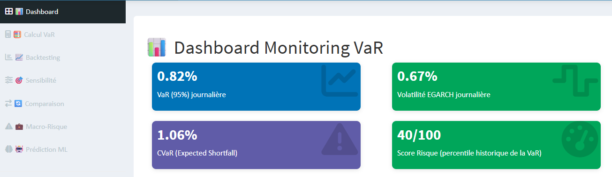

# Value-at-Risk sur le marché actions de la BRVM

Estimation et backtesting de la **Value-at-Risk (VaR)** sur l'indice BRVM Composite, en comparant trois approches : **paramétrique (RiskMetrics)**, **semi-paramétrique (GARCH-EVT)** et **simulation Monte Carlo**.

Mémoire de Master II, Data Science, Statistique & Économétrie (INSSEDS, Abidjan, 2025-2026), accompagné d'une **application Shiny** de monitoring du risque.



---

## Objectif

Déterminer quelle approche mesure le mieux le risque de marché sur la BRVM, un marché frontière peu liquide dont les rendements ne suivent pas une loi normale.

## Données

- **Indice** : BRVM Composite
- **Période** : du 1er juillet 2025 au 30 juin 2026
- **Observations** : 259 rendements logarithmiques journaliers
- **Découpage** : 207 observations pour l'estimation (80 %), 52 pour la validation hors échantillon (20 %)
- **Source** : Sika Finance

## Méthodologie

1. **Analyse exploratoire** : statistiques descriptives, stationnarité (ADF), normalité (Jarque-Bera), effets ARCH, autocorrélation (Ljung-Box)
2. **Sélection itérative du modèle** (GARCH, EGARCH, AR-GARCH), comparaison par AIC et BIC
3. **Estimation de la VaR à 95 %** selon trois approches :
   - Paramétrique : RiskMetrics
   - Semi-paramétrique : GARCH-EVT (méthode Peaks Over Threshold)
   - Simulation Monte Carlo
4. **Backtesting hors échantillon** : tests de Kupiec et de Christoffersen
5. **Robustesse** : bootstrap par blocs (B = 1 000, blocs de 5 observations)

## Principaux résultats

**Données** : queues épaisses (Jarque-Bera p = 0,007), pas d'effet ARCH classique (ARCH-LM p = 0,83), mais forte autocorrélation des rendements (Ljung-Box p = 0,006), typique d'un marché peu liquide.

**Modèle retenu** : **AR(5)-GARCH(1,1) avec loi de Student** (4,5 degrés de liberté). Tous les diagnostics des résidus sont validés. Les retards 4 et 5 révèlent une **structure hebdomadaire** dans la façon dont l'information se reflète dans les cours.

| Approche | VaR 95 % | Violations (sur 52) | Kupiec p-value | Verdict |
|---|---|---|---|---|
| RiskMetrics | 1,04 % | 0 | 0,021 | ❌ Rejeté (trop conservateur) |
| GARCH-EVT | 0,92 % | 1 | 0,247 | ✅ Validé |
| Monte Carlo | 0,88 % | 1 | 0,247 | ✅ Validé |

**Conclusion** : les approches **GARCH-EVT et Monte Carlo** sont validées, avec des performances statistiquement équivalentes. Le bootstrap confirme ce verdict : le taux de 5 % attendu se trouve dans l'intervalle de confiance [0 % ; 5,77 %].

### Tableaux de résultats

| N° | Tableau |
|---|---|
| T1 | [Statistiques descriptives](Results/Table/T1_statistiques_descriptives.csv) |
| T2 | [Test de stationnarité ADF](Results/Table/T2_test_stationnarite_ADF.csv) |
| T3 | [Tests de normalité](Results/Table/T3_tests_normalite.csv) |
| T4 | [Test ARCH-LM sur les rendements](Results/Table/T4_test_ARCH_LM_rendements.csv) |
| T5 | [Comparaison AIC / BIC](Results/Table/T5_comparaison_AIC_BIC.csv) |
| T6 | [Paramètres GARCH(1,1)](Results/Table/T6_parametres_GARCH11.csv) |
| T7 | [Diagnostics des résidus](Results/Table/T7_diagnostics_residus.csv) |
| T8 | [Persistance de la volatilité](Results/Table/T8_persistance_volatilite.csv) |
| T9 | [Paramètres EVT](Results/Table/T9_parametres_EVT.csv) |
| T10 | [VaR 95 % des trois modèles](Results/Table/T10_VaR_95_trois_modeles.csv) |
| T11 | [Backtesting complet](Results/Table/T11_backtesting_complet.csv) |
| T12 | [Robustesse par bootstrap](Results/Table/T12_bootstrap_robustesse.csv) |
| T13 | [Paramètres AR-GARCH-t](Results/Table/T13_parametres_AR1_GARCH_t.csv) |
| T14 | [Diagnostics AR-GARCH-t](Results/Table/T14_diagnostics_AR1_GARCH_t.csv) |
| T15 | [VaR du modèle final](Results/Table/T15_VaR_modele_final.csv) |
| T16 | [Paramètres du modèle final](Results/Table/T16_parametres_modele_final.csv) |
| T17 | [Diagnostics du modèle final](Results/Table/T17_diagnostics_modele_final.csv) |
| T18 | [VaR et backtesting du modèle final](Results/Table/T18_VaR_backtesting_final.csv) |

## Application Shiny

- **Dashboard** : VaR, CVaR, volatilité et score de risque
- **Calcul VaR** : comparaison des trois approches
- **Backtesting** : validation des modèles
- **Sensibilité** : impact des paramètres
- **Comparaison** des modèles
- **Macro-Risque** : lien avec l'environnement macroéconomique
- **Prédiction ML** : approche par machine learning
- **Export** des résultats en PDF et CSV

### Lancer l'application

```bash
git clone https://github.com/Yasmine0701/var-brvm.git
```

Installer les packages R listés dans `requirements.txt`, puis dans R :

```r
shiny::runApp("var-brvm")
```

## Structure du projet

```text
var-brvm/
├── app.R, ui.R, server.R, global.R   # Application Shiny
├── modules/      # Onglets de l'application
├── functions/    # Fonctions de calcul (VaR, GARCH, EVT, ML)
├── www/          # Ressources graphiques
├── Data/         # Données BRVM
├── script/       # Scripts d'analyse du mémoire
└── Results/      # Tableaux (T1 à T18) et figures
```

## Outils

R · Shiny · rugarch · théorie des valeurs extrêmes · simulation Monte Carlo · plotly

## Auteure

**Yasmine Coulibaly**, Data Scientist, finance de marché et gestion des risques
[LinkedIn](https://www.linkedin.com/in/peteninta-lagnon-coulibaly) · coulyas74@gmail.com

Sous la direction de M. AKPOSSO Didier Martial (INSSEDS)
